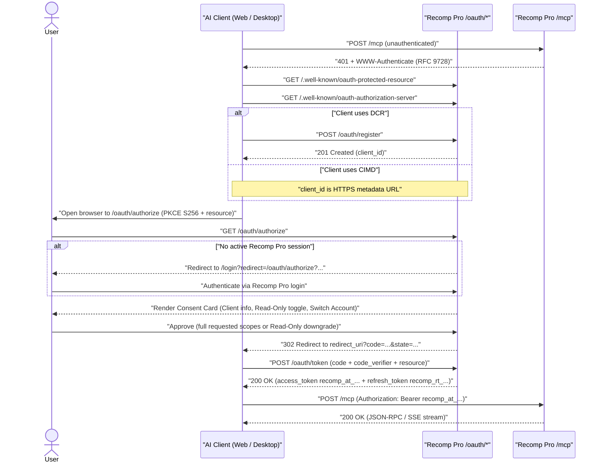
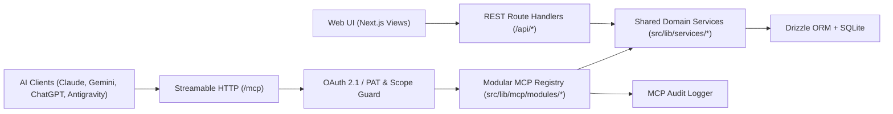

# Recomp Pro Embedded MCP Server — Technical Specification

**Status:** Proposed  
**Target Branch:** `preview` (via phased implementation PRs)  
**Runtime Stack:** Next.js 16 (Node.js 22+, TypeScript), Drizzle ORM (`@libsql/client`), `@modelcontextprotocol/sdk`

---

## 1. Overview & Goals

This document specifies the architecture, security model, protocol contracts, database schema, and user experience for an **embedded Model Context Protocol (MCP) Server** inside **RecompPro-core**.

The MCP server enables external AI assistants and agentic IDEs—both **web/cloud** and **desktop/CLI**—to securely inspect and manage a user's Recomp Pro health, body composition, strength training, integration sync, and shared report data using natural language.

### Design Objectives
1. **100% Native Monolith Embedding:** Run inside the existing Recomp Pro Next.js 16 standalone container (`RecompPro-core`) with zero Python dependencies and direct access to Drizzle ORM and shared domain services.
2. **Broad Agent Compatibility (Web & Desktop):** Support **Streamable HTTP** (`/mcp`) and **OAuth 2.1** (both **CIMD** and **DCR** with mandatory **PKCE `S256`** and rotating refresh tokens), plus **Personal Access Tokens (PATs)** via `Authorization: Bearer`, ensuring seamless interoperability with **Gemini (Web & CLI)**, **Antigravity**, **Claude (Web & Desktop)**, **ChatGPT**, **Cursor**, and **VS Code**.
3. **Full Read & Safe Write Coverage:** Expose all current domain capabilities (Profile, Biometrics, Workouts & Muscle Readiness, Integrations Sync, Shared Links) with explicit **Read-Only** vs **Read+Write** consent controls and hard exclusions for high-risk account/credential operations.
4. **Future-Proof Parity:** Guarantee that upcoming Recomp Pro features (such as **Nutrition**, **Manual Biometric Entry**, and **Workout Logging/Routines**) automatically gain MCP coverage through a shared Domain Service Layer and modular MCP Registry.

---

## 2. Deployment Topology & Runtime Configuration

### 2.1 Embedded Container Topology
Recomp Pro operates as a single self-hosted Node.js 22+ container (`output: "standalone"`). The MCP server is mounted directly as Next.js Route Handlers and App Router pages within the same process, sharing:
- SQLite persistence (`/app/data/recomp_pro.db` via Drizzle ORM + `@libsql/client`)
- Existing user accounts, JWT web sessions, and AES-256-GCM integration credential vault (`src/lib/crypto.ts`)
- Shared Domain Services (`src/lib/services/*`)

### 2.2 Canonical Endpoints

| Route | Method(s) | Purpose |
| :--- | :--- | :--- |
| `/mcp` | `POST`, `GET`, `DELETE`, `OPTIONS` | Primary MCP Streamable HTTP endpoint (JSON-RPC 2.0 + SSE) |
| `/.well-known/oauth-protected-resource` | `GET`, `OPTIONS` | RFC 9728 Protected Resource Metadata (root discovery) |
| `/.well-known/oauth-protected-resource/mcp` | `GET`, `OPTIONS` | RFC 9728 Protected Resource Metadata (path-scoped discovery) |
| `/.well-known/oauth-authorization-server` | `GET`, `OPTIONS` | RFC 8414 Authorization Server Metadata |
| `/oauth/register` | `POST`, `OPTIONS` | RFC 7591 Dynamic Client Registration (DCR) |
| `/oauth/authorize` | `GET`, `POST` | OAuth 2.1 Authorization & User Consent UI / Decision Handler |
| `/oauth/token` | `POST`, `OPTIONS` | OAuth 2.1 Token Endpoint (`authorization_code`, `refresh_token`) |
| `/oauth/revoke` | `POST`, `OPTIONS` | RFC 7009 Token Revocation Endpoint |
| `/icon.png` | `GET`, `HEAD` | Canonical 512x512 PNG brand icon for SEP-973 `serverInfo` |

### 2.3 Runtime Environment Variables (Zero-Rebuild)
Consistent with `DEPLOYMENT.md`, all MCP configuration variables are evaluated dynamically at request/startup time without requiring a Docker image rebuild:

| Variable | Default | Description |
| :--- | :--- | :--- |
| `ENABLE_MCP_SERVER` | `true` | Enables or disables `/mcp`, `/.well-known/*`, `/oauth/*`, and the Profile **AI / MCP** UI tab. When `false`, MCP endpoints return `404` or `503`. |
| `NEXT_PUBLIC_APP_URL` | `http://localhost` | Canonical public origin (must be `https://...` in production) used as OAuth `issuer`, RFC 9728 `resource`, and `WWW-Authenticate` metadata URL base. |
| `MCP_ACCESS_TOKEN_TTL_SECONDS` | `3600` | OAuth access token lifetime (1 hour). |
| `MCP_REFRESH_TOKEN_TTL_DAYS` | `90` | Sliding refresh token lifetime (90 days). |
| `MCP_AUDIT_LOG_MAX_PER_USER` | `500` | Maximum retained `mcp_audit_logs` rows per user before oldest-first pruning. |
| `MCP_AUDIT_LOG_RETENTION_DAYS` | `90` | Maximum age in days for retained `mcp_audit_logs` rows. |

### 2.4 Reverse Proxy Requirements
Remote cloud AI clients (Claude Web, ChatGPT, Gemini Web) require a publicly reachable **HTTPS** endpoint:
- **TLS Termination:** Terminate TLS at the reverse proxy (Caddy, Nginx, Traefik, Cloudflare Tunnel) and forward `X-Forwarded-Proto: https` and `X-Forwarded-Host`.
- **Unbuffered Streaming:** Disable proxy response buffering (`flush_interval -1` in Caddy / `proxy_buffering off` in Nginx) on `/mcp` so SSE frames stream immediately.
- **No Forced Trailing Redirects on `/mcp`:** Ensure proxies do not issue 308/301 redirects on `POST /mcp`, as some MCP clients reject POST redirects during handshake.

---

## 3. Transport Layer, CORS & Protocol Fidelity

### 3.1 Streamable HTTP (`@modelcontextprotocol/sdk`)
- Use the official TypeScript `@modelcontextprotocol/sdk` (`McpServer` + `WebStandardStreamableHTTPServerTransport`).
- **Stateless Mode (`sessionIdGenerator: undefined`):** Next.js Route Handlers may scale or recycle instances without in-memory session affinity. Running Streamable HTTP in stateless mode guarantees every `POST /mcp` request is self-contained, authenticated by its Bearer token, and resilient across container restarts.
- **GET /mcp & DELETE /mcp:** Supported cleanly per the MCP Streamable HTTP specification (returning `405 Method Not Allowed` or SSE/session termination semantics as defined by the transport).

### 3.2 SEP-973 Metadata & Branding
Implement official MCP SEP-973 `serverInfo` fields on `McpServer`:
- `name`: `"recomp-pro"`
- `title`: `"Recomp Pro"`
- `version`: read dynamically from `VERSION` / `package.json`
- `websiteUrl`: resolved from `NEXT_PUBLIC_APP_URL`
- `icons`: `[{ src: "<origin>/icon.png", mimeType: "image/png", sizes: ["512x512"] }]`

Serve a 512x512 PNG at `GET` / `HEAD /icon.png` and expose an in-protocol `about` tool (aligned with `fiainvest-mcp` ADR-0007).

### 3.3 CORS & `OPTIONS` Preflight Handling
Browser-based MCP clients execute cross-origin `fetch()` calls to discovery, OAuth, and `/mcp` endpoints. Both `src/middleware.ts` and explicit route-level `OPTIONS` handlers must support CORS preflight:
- Extend `src/middleware.ts` `config.matcher` to cover `["/api/:path*", "/uploads/:path*", "/mcp", "/.well-known/:path*", "/oauth/:path*"]`.
- Return HTTP `204 No Content` on `OPTIONS` for `/mcp`, `/.well-known/*`, and `/oauth/*` with:
  - `Access-Control-Allow-Origin: *` (or echoed `Origin` when credentials are not used on token-bearing stateless routes)
  - `Access-Control-Allow-Methods: GET, POST, DELETE, OPTIONS`
  - `Access-Control-Allow-Headers: Authorization, Content-Type, Accept, Mcp-Session-Id, Mcp-Protocol-Version`
  - `Access-Control-Expose-Headers: Mcp-Session-Id, WWW-Authenticate`
  - `Access-Control-Max-Age: 86400`

---

## 4. Authentication & OAuth 2.1 Authorization Server

### 4.1 Client Compatibility Matrix

| Client | Environment | Transport | Client Identification | Auth Mechanism |
| :--- | :--- | :--- | :--- | :--- |
| **Claude Web** (`claude.ai`) | Browser / Cloud | Streamable HTTP | CIMD or DCR (RFC 7591) | OAuth 2.1 + PKCE `S256` |
| **Claude Desktop** | Desktop | Streamable HTTP (`mcp-remote` or native) | DCR / CIMD or PAT | OAuth 2.1 + PKCE `S256` or Bearer PAT |
| **ChatGPT** (Connectors / Apps) | Cloud / Web | Streamable HTTP | DCR (RFC 7591) / CIMD | OAuth 2.1 + PKCE `S256` |
| **Gemini Web** | Cloud / Web | Streamable HTTP | DCR / CIMD / OAuth | OAuth 2.1 + PKCE `S256` |
| **Gemini CLI** | Terminal | Streamable HTTP | DCR (loopback redirect) or PAT | OAuth 2.1 + PKCE `S256` or Bearer PAT |
| **Antigravity** | IDE / Agent | Streamable HTTP | CIMD / DCR / PAT | OAuth 2.1 + PKCE `S256` or Bearer PAT |
| **Cursor / VS Code** | Desktop IDE | Streamable HTTP | DCR (loopback redirect) or PAT | OAuth 2.1 + PKCE `S256` or Bearer PAT |

### 4.2 Discovery & HTTP 401 Challenge (RFC 9728 & RFC 8414)

#### Unauthenticated `/mcp` Challenge
Any request to `/mcp` without a valid `Authorization: Bearer <token>` header receives `HTTP 401 Unauthorized` with:
```http
HTTP/1.1 401 Unauthorized
WWW-Authenticate: Bearer resource_metadata="https://<origin>/.well-known/oauth-protected-resource", scope="recomp:read"
```
If a request supplies a valid token lacking the required scope for a specific `tools/call`, the MCP server returns a tool error (or HTTP `403` `insufficient_scope` at the HTTP layer if applicable) indicating the missing scope.

#### Protected Resource Metadata (`GET /.well-known/oauth-protected-resource` and `/.well-known/oauth-protected-resource/mcp`)
```json
{
  "resource": "https://<origin>/mcp",
  "authorization_servers": ["https://<origin>"],
  "scopes_supported": [
    "recomp:read",
    "recomp:write",
    "profile:read",
    "profile:write",
    "biometrics:read",
    "biometrics:write",
    "workouts:read",
    "workouts:write",
    "integrations:read",
    "integrations:write",
    "shared_links:read",
    "shared_links:write",
    "nutrition:read",
    "nutrition:write"
  ],
  "bearer_methods_supported": ["header"],
  "resource_documentation": "https://<origin>/profile?tab=mcp"
}
```

#### Authorization Server Metadata (`GET /.well-known/oauth-authorization-server`)
```json
{
  "issuer": "https://<origin>",
  "authorization_endpoint": "https://<origin>/oauth/authorize",
  "token_endpoint": "https://<origin>/oauth/token",
  "registration_endpoint": "https://<origin>/oauth/register",
  "revocation_endpoint": "https://<origin>/oauth/revoke",
  "scopes_supported": [
    "recomp:read",
    "recomp:write",
    "profile:read",
    "profile:write",
    "biometrics:read",
    "biometrics:write",
    "workouts:read",
    "workouts:write",
    "integrations:read",
    "integrations:write",
    "shared_links:read",
    "shared_links:write",
    "nutrition:read",
    "nutrition:write"
  ],
  "response_types_supported": ["code"],
  "grant_types_supported": ["authorization_code", "refresh_token"],
  "token_endpoint_auth_methods_supported": ["none"],
  "code_challenge_methods_supported": ["S256"],
  "client_id_metadata_document_supported": true,
  "revocation_endpoint_auth_methods_supported": ["none"]
}
```

### 4.3 Dual Client Identification: CIMD + DCR (RFC 7591)

To support every major web and desktop client without manual admin registration:

1. **Client ID Metadata Document (CIMD — `draft-ietf-oauth-client-id-metadata-document`):**
   - When `client_id` begins with `https://`, parse it as a URL (no userinfo, no fragment, valid HTTPS origin).
   - **Anti-SSRF Protection:** Resolve DNS before connecting and reject any loopback (`127.0.0.0/8`, `::1`), private RFC 1918 (`10.0.0.0/8`, `172.16.0.0/12`, `192.168.0.0/16`), link-local / cloud metadata (`169.254.0.0/16`, `fe80::/10`), or unique-local IPv6 (`fc00::/7`) targets. Enforce a 3-second timeout, max 64 KiB JSON body, and redirect blocking.
   - Verify the fetched JSON contains matching `client_id` and non-empty `redirect_uris`, then cache in memory for 1 hour (keyed by `client_id`).
   - Upsert client display metadata (`client_name`, `logo_uri`, `client_uri`, `redirect_uris`) into `mcp_oauth_clients` (`registration_type = 'cimd'`).

2. **Dynamic Client Registration (DCR — RFC 7591 `POST /oauth/register`):**
   - Accepts public clients (`token_endpoint_auth_method: "none"`, `grant_types` subset of `["authorization_code", "refresh_token"]`, `response_types: ["code"]`).
   - Validates `redirect_uris`: every URI must be `https://...` or loopback `http://localhost:<port>/...` / `http://127.0.0.1:<port>/...` (or explicit custom native app schemes only if declared safe, never `javascript:` or `data:`).
   - Generates an opaque `client_id` (`recomp_client_<random>`) and persists into `mcp_oauth_clients` (`registration_type = 'dcr'`).
   - Enforces IP-based rate limiting and automated pruning of stale ungranted DCR clients older than 30 days.

### 4.4 Authorization Flow, PKCE `S256` & 1-Click Consent



### 4.5 Security & Token Lifecycle Invariants
- **Mandatory PKCE `S256`:** Reject `plain` or missing `code_challenge` at `/oauth/authorize` and missing `code_verifier` at `/oauth/token`.
- **RFC 8707 Resource Binding:** When `resource` is supplied, verify it matches `https://<origin>/mcp` (or `https://<origin>`) and bind it to the issued auth code and access token.
- **Opaque Digest-Only Persistence:** Access tokens (`recomp_at_<48B_base64url>`), refresh tokens (`recomp_rt_<48B_base64url>`), authorization codes, and PATs (`recomp_pat_<48B_base64url>`) are stored strictly as **SHA-256 hex digests**. Raw secrets are returned once upon issuance and never logged or stored.
- **Refresh Token Rotation & Reuse Detection:** Each `grant_type=refresh_token` exchange issues a fresh refresh token in the same `family_id` and marks the prior one rotated. Presenting an already-rotated refresh token immediately revokes the entire token family and grant.
- **Personal Access Tokens (PATs):** Users may generate long-lived scoped PATs in **Profile > AI / MCP** for headless/CLI/desktop agents that do not support interactive OAuth. PATs authenticate exclusively via `Authorization: Bearer recomp_pat_...`.
- **Strict Prohibition of Query Parameter Auth:** `?token=` and `?api_key=` query parameters on `/mcp` are **explicitly forbidden** to prevent credential leakage in access logs, browser history, and `Referer` headers.

---

## 5. Authorization Model: Hybrid Scopes & Safety Boundaries

### 5.1 Hybrid Hierarchical Scopes

| Scope | Grants Access To |
| :--- | :--- |
| `recomp:read` | All current and future **read** tools and resources across all domains |
| `recomp:write` | All current and future **write** tools across all allowed domains (does **not** implicitly grant `recomp:read`; clients request `recomp:read recomp:write` and read/write checks are evaluated independently) |
| `profile:read` / `profile:write` | User profile & target metrics (`get_user_profile`, `update_user_profile`) |
| `biometrics:read` / `biometrics:write` | Body composition records, summaries, stars, record deletion |
| `workouts:read` / `workouts:write` | Workout logs, stats, progressions, readiness (and future manual workout logging) |
| `integrations:read` / `integrations:write` | Integration status & triggering Fitdays/Hevy syncs |
| `shared_links:read` / `shared_links:write` | Listing, inspecting, creating, updating, and deleting shared report links |
| `nutrition:read` / `nutrition:write` | Reserved for the upcoming Nutrition module (`/nutrition`) |

#### Scope Resolution Rule
A tool requiring `<domain>:<op>` (where `<op>` is `read` or `write`) is authorized if and only if the caller's token grants:
$$\text{hasScope}(\text{token}, \text{domain} + \text{":"} + \text{op}) \lor \text{hasScope}(\text{token}, \text{"recomp:"} + \text{op})$$

#### Read-Only Downgrade at Consent & PAT Creation
- On `/oauth/authorize`, when a client requests write scopes (`recomp:write` or `*:write`), the UI presents a prominent **"Allow Read-Only access only"** toggle/option.
- Selecting Read-Only strips all `:write` scopes from the granted scope list and issues a read-only token.
- `tools/list` dynamically filters out write tools whose scope is absent from the active token, preventing the LLM from even attempting unauthorized mutations.

### 5.2 Official MCP Tool Annotations
Every tool registers standard MCP `annotations`:
- **Read tools:** `{ readOnlyHint: true, destructiveHint: false, idempotentHint: true, openWorldHint: false }`
- **Non-destructive write tools** (e.g., `update_user_profile`, `toggle_biometric_record_star`, `create_shared_link`, `update_shared_link`): `{ readOnlyHint: false, destructiveHint: false, idempotentHint: <true|false>, openWorldHint: false }`
- **External-API sync triggers** (`trigger_fitdays_sync`, `trigger_hevy_sync`): `{ readOnlyHint: false, destructiveHint: false, idempotentHint: true, openWorldHint: true }`
- **Destructive write tools** (`delete_biometric_records`, `delete_shared_link`): `{ readOnlyHint: false, destructiveHint: true, idempotentHint: false, openWorldHint: false }`

### 5.3 Hard Security Exclusions (Web-UI-Only)
The following operations are **permanently excluded** from the MCP surface and may only be executed interactively in the Recomp Pro Web UI:
- Account deletion (`POST /api/users/me/delete-account`, `DELETE /api/users/me`)
- Full user data wipe (`POST /api/users/me/delete-data`)
- Password changes, password resets, and email verification / email change flows
- Third-party integration credential setup, disconnection, or webhook token rotation (`POST/DELETE /api/integrations/{fitdays,hevy}/*`)
- Managing OAuth grants, revoking apps, or creating/revoking Personal Access Tokens (prevents privilege escalation or self-persistence by an agent)

---

## 6. Database Schema Additions (Drizzle ORM / SQLite)

Schema changes will be added to `src/db/schema.ts` with Drizzle migrations generated via `npm run db:generate` and applied automatically at startup via `src/instrumentation.ts`. All user-owned tables use `ON DELETE CASCADE` referencing `users.id`.

### 6.1 `mcp_oauth_clients`
Stores both CIMD-cached clients and DCR-registered public clients.
- `id`: `integer` PK autoincrement
- `clientId`: `text` NOT NULL UNIQUE (HTTPS URL for CIMD or `recomp_client_...` for DCR)
- `registrationType`: `text` NOT NULL (`"cimd" | "dcr"`)
- `clientName`: `text` NOT NULL
- `clientUri`: `text` (nullable)
- `logoUri`: `text` (nullable)
- `redirectUrisJson`: `text` NOT NULL (JSON string array)
- `metadataJson`: `text` (nullable, full cached CIMD/DCR payload)
- `metadataExpiresAt`: `sqliteDateTime` (nullable, CIMD TTL)
- `lastUsedAt`: `sqliteDateTime` (nullable)
- `createdAt`: `sqliteDateTime` NOT NULL

### 6.2 `mcp_oauth_auth_codes`
Short-lived (5-minute TTL), single-use PKCE authorization codes.
- `id`: `integer` PK autoincrement
- `codeHash`: `text` NOT NULL UNIQUE (SHA-256 hex)
- `clientId`: `text` NOT NULL (references `mcp_oauth_clients.clientId` ON DELETE CASCADE)
- `userId`: `integer` NOT NULL (references `users.id` ON DELETE CASCADE)
- `redirectUri`: `text` NOT NULL
- `scope`: `text` NOT NULL (space-separated granted scopes)
- `resource`: `text` (nullable, RFC 8707)
- `codeChallenge`: `text` NOT NULL
- `codeChallengeMethod`: `text` NOT NULL (`"S256"`)
- `expiresAt`: `sqliteDateTime` NOT NULL
- `consumedAt`: `sqliteDateTime` (nullable)
- `createdAt`: `sqliteDateTime` NOT NULL

### 6.3 `mcp_oauth_grants`
Tracks user-approved application connections displayed in **Profile > AI / MCP**.
- `id`: `text` PK (UUID)
- `userId`: `integer` NOT NULL (references `users.id` ON DELETE CASCADE)
- `clientId`: `text` NOT NULL (references `mcp_oauth_clients.clientId` ON DELETE CASCADE)
- `grantedScopes`: `text` NOT NULL (space-separated)
- `lastUsedAt`: `sqliteDateTime` (nullable)
- `revokedAt`: `sqliteDateTime` (nullable)
- `createdAt`: `sqliteDateTime` NOT NULL
- `updatedAt`: `sqliteDateTime` NOT NULL
- Unique index on `(userId, clientId)` for active grant upserts/updates.

### 6.4 `mcp_oauth_tokens`
Stores SHA-256 digests of access tokens and rotating refresh tokens.
- `id`: `integer` PK autoincrement
- `grantId`: `text` NOT NULL (references `mcp_oauth_grants.id` ON DELETE CASCADE)
- `userId`: `integer` NOT NULL (references `users.id` ON DELETE CASCADE)
- `clientId`: `text` NOT NULL
- `tokenType`: `text` NOT NULL (`"access" | "refresh"`)
- `tokenHash`: `text` NOT NULL UNIQUE (SHA-256 hex)
- `familyId`: `text` NOT NULL (shared across refresh token rotations for reuse detection)
- `scope`: `text` NOT NULL
- `resource`: `text` (nullable)
- `expiresAt`: `sqliteDateTime` NOT NULL
- `rotatedAt`: `sqliteDateTime` (nullable)
- `revokedAt`: `sqliteDateTime` (nullable)
- `createdAt`: `sqliteDateTime` NOT NULL

### 6.5 `mcp_personal_access_tokens`
User-generated Bearer tokens for desktop/CLI MCP clients.
- `id`: `text` PK (UUID)
- `userId`: `integer` NOT NULL (references `users.id` ON DELETE CASCADE)
- `name`: `text` NOT NULL (user-friendly label, e.g. `"Antigravity Desktop"`)
- `tokenPrefix`: `text` NOT NULL (first 12 chars for UI identification, e.g. `recomp_pat_a1b2`)
- `tokenHash`: `text` NOT NULL UNIQUE (SHA-256 hex)
- `scopes`: `text` NOT NULL (space-separated)
- `lastUsedAt`: `sqliteDateTime` (nullable)
- `expiresAt`: `sqliteDateTime` (nullable, optional user-selected expiry)
- `revokedAt`: `sqliteDateTime` (nullable)
- `createdAt`: `sqliteDateTime` NOT NULL

### 6.6 `mcp_audit_logs`
Bounded audit trail of MCP tool/resource invocations visible in **Profile > AI / MCP**.
- `id`: `integer` PK autoincrement
- `userId`: `integer` NOT NULL (references `users.id` ON DELETE CASCADE)
- `authMethod`: `text` NOT NULL (`"oauth" | "pat"`)
- `clientLabel`: `text` NOT NULL (OAuth `clientName` or PAT `name`)
- `primitiveType`: `text` NOT NULL (`"tool" | "resource" | "prompt"`)
- `primitiveName`: `text` NOT NULL
- `accessMode`: `text` NOT NULL (`"read" | "write"`)
- `status`: `text` NOT NULL (`"success" | "denied" | "error"`)
- `errorCode`: `text` (nullable, sanitized code only — no PII or secrets)
- `durationMs`: `integer` NOT NULL
- `createdAt`: `sqliteDateTime` NOT NULL
- Index on `(userId, createdAt)`.
- **Retention Pruning:** Background/lazy pruning enforces both `MCP_AUDIT_LOG_MAX_PER_USER` (default `500`) and `MCP_AUDIT_LOG_RETENTION_DAYS` (default `90`), alongside periodic cleanup of expired `mcp_oauth_auth_codes`, `mcp_oauth_tokens`, and unused DCR clients.

---

## 7. Extensibility Architecture (Current & Future Feature Parity)

### 7.1 Shared Domain Service Layer
Currently, business logic resides inside Next.js Route Handlers (`src/app/api/*`). To prevent drift between the Web UI and MCP tools, business logic will be extracted into pure TypeScript Domain Services under `src/lib/services/`:



### 7.2 Proposed Directory Structure
```text
src/
├── lib/
│   ├── services/
│   │   ├── profileService.ts
│   │   ├── biometricsService.ts
│   │   ├── workoutsService.ts
│   │   ├── integrationsService.ts
│   │   └── sharedLinksService.ts
│   └── mcp/
│       ├── server.ts            # McpServer factory, SEP-973 serverInfo, transport wiring
│       ├── registry.ts          # Collects modules, enforces scope & audit wrappers
│       ├── auth.ts              # Bearer token (OAuth/PAT) resolution & scope checker
│       ├── oauth/
│       │   ├── cimd.ts          # Anti-SSRF CIMD fetcher + 1h TTL cache
│       │   ├── dcr.ts           # RFC 7591 client registration & validation
│       │   ├── pkce.ts          # S256 verification
│       │   └── tokens.ts        # Digest-only issuance, rotation, reuse detection
│       ├── audit.ts             # Sanitized audit logging & retention pruning
│       └── modules/
│           ├── system.ts        # `about` tool
│           ├── profile.ts       # Profile tools & resources
│           ├── biometrics.ts    # Biometrics tools, resources & prompts
│           ├── workouts.ts      # Workouts, progression & readiness tools/resources/prompts
│           ├── integrations.ts  # Integration status & sync tools/resources
│           └── sharedLinks.ts   # Shared link management tools & prompts
└── app/
    ├── mcp/route.ts
    ├── icon.png/route.ts
    ├── .well-known/
    │   ├── oauth-protected-resource/route.ts
    │   ├── oauth-protected-resource/mcp/route.ts
    │   └── oauth-authorization-server/route.ts
    └── oauth/
        ├── register/route.ts
        ├── authorize/page.tsx
        ├── authorize/decision/route.ts
        ├── token/route.ts
        └── revoke/route.ts
```

### 7.3 Canonical Naming Conventions
- **Identifiers:** 100% `en-US` across all MCP primitives.
- **Tools:** `snake_case` verb-noun pairs (e.g., `list_biometric_records`, `get_muscle_readiness`, `trigger_hevy_sync`).
- **Resources:** `recomp://<domain>/<subpath>` URIs.
- **Prompts:** `kebab-case` identifiers (e.g., `recomp-progress-review`).
- **Zero Synthetic Misrepresentation:** Tools return authoritative database values and explicit calculation provenance (mirroring `fiainvest-mcp` ADR-0009).

### 7.4 Future Feature Parity Contract
To guarantee every future Recomp Pro feature (e.g., **Nutrition**, **Manual Biometric Entry**, **Workout Logging**) ships with MCP support:
1. New backend capabilities must be implemented in `src/lib/services/<domain>Service.ts` first, with `/api/*` Route Handlers acting as thin HTTP adapters.
2. Each new domain adds a module under `src/lib/mcp/modules/<domain>.ts` registering its Tools, Resources, Prompts, and scopes in `src/lib/mcp/registry.ts`.
3. `AGENTS.md` will include a parity invariant requiring MCP module evaluation/updates whenever a new domain service or API capability is introduced, backed by a registry parity test (`src/lib/mcp/__tests__/registry.test.ts`) validating tool schemas, annotations, and scope declarations.

---

## 8. MCP Primitive Catalog (v1 + Roadmap)

### 8.1 v1 Tools Catalog

| Tool Name | Required Scope | Mode | Annotations (`readOnly`, `destructive`, `idempotent`, `openWorld`) | Key Inputs & Description |
| :--- | :--- | :--- | :--- | :--- |
| `about` | *(any valid token)* | Read | `true, false, true, false` | Returns Recomp Pro version, enabled modules, user's granted scopes, and server capabilities. |
| `get_user_profile` | `profile:read` | Read | `true, false, true, false` | Returns display name, gender, birthday, height, target weight, preferred language, and account timestamps. |
| `update_user_profile` | `profile:write` | Write | `false, false, true, false` | Updates `display_name`, `gender`, `birthday`, `height_cm`, `target_weight_kg`, or `preferred_language` (excludes email change). |
| `get_biometrics_summary` | `biometrics:read` | Read | `true, false, true, false` | Returns aggregated body composition progress (`total_records`, starting vs. current weight, body fat %, fat mass, muscle mass, skeletal muscle mass, deltas, and weight history). Optional `period` (`all`, `1m`, `3m`, `6m`, `1y`). |
| `list_biometric_records` | `biometrics:read` | Read | `true, false, true, false` | Paginated/date-filtered list of biometric scans (`from`, `to`, `starred_only`, `limit`, `offset`, `include_segmental`). |
| `get_biometric_record` | `biometrics:read` | Read | `true, false, true, false` | Full core + 5-segment bioimpedance metrics and attached report metadata (filename, mime type, size — no raw binary dump) for a `record_id`. |
| `toggle_biometric_record_star` | `biometrics:write` | Write | `false, false, true, false` | Sets or toggles `starred` on `record_id` and automatically refreshes `auto_share_starred` snapshots. |
| `delete_biometric_records` | `biometrics:write` | Write | `false, true, false, false` | Permanently deletes specific `record_ids` belonging to the user. Requires explicit user confirmation in client UI (`destructiveHint: true`). |
| `list_workouts` | `workouts:read` | Read | `true, false, true, false` | Paginated workout history (`page`, `page_size`, `from`, `to`) with duration, volume, session/EPOC/total calories, effective RPE, and PR counts. |
| `get_workout_details` | `workouts:read` | Read | `true, false, true, false` | Detailed workout breakdown by `workout_id` including exercises, sets, reps, load, RPE sanitization, PR deltas, and next-load double-progression prescription. |
| `get_workout_stats` | `workouts:read` | Read | `true, false, true, false` | Aggregated training analytics for `period` (`all`, `1m`, `3m`, `6m`, `1y`), current week summary, chart series, and calendar metadata. |
| `get_workout_progression` | `workouts:read` | Read | `true, false, true, false` | Exercise-level PRs and load progression items for `period` (`all`, `1m`, `3m`, `6m`, `1y`). |
| `get_muscle_readiness` | `workouts:read` | Read | `true, false, true, false` | Personalized muscle group recovery percentages, remaining recovery hours, and localized training recommendation. |
| `list_integrations` | `integrations:read` | Read | `true, false, true, false` | Lists connected Fitdays/Hevy integrations, status, last sync timestamp, last error, and non-secret config (redacting webhook secrets/tokens). |
| `trigger_fitdays_sync` | `integrations:write` | Write | `false, false, true, true` | Triggers incremental or `force_full` Fitdays Cloud sync for the configured member profile and returns inserted/updated counts. |
| `trigger_hevy_sync` | `integrations:write` | Write | `false, false, true, true` | Triggers incremental or `force_full` Hevy workout sync and returns synced workout counts. |
| `list_shared_links` | `shared_links:read` | Read | `true, false, true, false` | Lists user's shared report links, expiration, password-protection status, `auto_share_starred` flag, and access counts. |
| `get_shared_link_details` | `shared_links:read` | Read | `true, false, true, false` | Returns shared link metadata, included record summaries, and sanitized access audit summary (timestamps/status, no visitor IP). |
| `create_shared_link` | `shared_links:write` | Write | `false, false, false, false` | Creates a snapshot shared link (`description`, `entry_ids`, `auto_share_starred`, `include_attachments`, optional `expires_at`, optional `password`) respecting `MAX_ACTIVE_SHARED_LINKS`. |
| `update_shared_link` | `shared_links:write` | Write | `false, false, true, false` | Updates `description`, `expires_at`, `auto_share_starred`, or password settings on an existing `link_id`. |
| `delete_shared_link` | `shared_links:write` | Write | `false, true, false, false` | Permanently revokes and deletes a shared link by `link_id` (`destructiveHint: true`). |

### 8.2 v1 Resources Catalog (`recomp://`)

| Resource URI | Required Scope | Description |
| :--- | :--- | :--- |
| `recomp://profile` | `profile:read` | Authenticated user's profile and target body weight |
| `recomp://biometrics/latest` | `biometrics:read` | Most recent full biometric scan (core + segmental metrics) |
| `recomp://biometrics/summary` | `biometrics:read` | Overall body recomposition delta summary |
| `recomp://workouts/readiness` | `workouts:read` | Current muscle group recovery & training readiness snapshot |
| `recomp://workouts/stats/3m` | `workouts:read` | 3-month workout volume, frequency, and caloric expenditure summary |
| `recomp://integrations/status` | `integrations:read` | Sanitized Fitdays and Hevy connection & last-sync status |

### 8.3 v1 Prompts Catalog

| Prompt Name | Description |
| :--- | :--- |
| `recomp-progress-review` | Guides the AI to correlate recent biometric body-fat/lean-mass trends with training volume and target weight progress. |
| `training-readiness-brief` | Synthesizes muscle group recovery (`get_muscle_readiness`) and recent PR prescriptions (`get_workout_details`) into today's training recommendation. |
| `biometrics-segmental-analysis` | Evaluates bilateral symmetry (Left vs. Right Arms/Legs and Trunk) across recent scans. |
| `prepare-coach-report` | Summarizes key starred scans and recent workouts and assists the user in creating a `shared_link` for a coach or physician. |

### 8.4 Future Modules Blueprint
- **Nutrition (`nutrition:read`, `nutrition:write`):** Daily calorie/macro logs, TDEE vs. BMR + workout caloric expenditure energy balance (`recomp://nutrition/today`), meal logging tools.
- **Manual Biometric Entry (`biometrics:write`):** `create_biometric_record` / `import_biometrics_csv` once manual entry exists in the core UI.
- **Workout Logging & Routines (`workouts:write`):** `log_workout`, `create_routine` once native workout creation lands in the core app.

---

## 9. User Experience & Management UI

All new UI components must comply strictly with `docs/UI_AND_I18N_GUIDELINES.md`, modal dismissal ergonomics (`Escape` + backdrop click), and full translation key parity across `src/locales/en.json`, `src/locales/pt.json`, and `src/locales/es.json`.

### 9.1 Profile Tab: "AI / MCP" (`/profile`)
Add a dedicated **AI / MCP** tab inside the Profile view containing:
1. **MCP Endpoint & Quick-Connect Snippets:**
   - Displays the canonical Streamable HTTP URL (`<origin>/mcp`) with one-click copy.
   - Pre-formatted setup guides/snippets tailored for **Claude (Web & Desktop)**, **ChatGPT**, **Gemini (Web & CLI)**, and **Antigravity / Cursor / VS Code**.
   - Hidden or displays a disabled notice if `ENABLE_MCP_SERVER=false`.
2. **Connected AI Applications (OAuth Grants):**
   - Lists active OAuth 2.1 grants (`clientName`, `registrationType`, granted scopes badge—highlighting `Read-Only` vs `Read & Write`, created/last-used timestamps) with a **Revoke** button (`POST /oauth/revoke` / internal revocation endpoint).
3. **Personal Access Tokens (PATs):**
   - Modal/dialog to create a new token with a custom label, scope selector (`Read-Only` default or `Read & Write`, plus optional domain restriction), and optional expiration.
   - One-time secret reveal modal with copy button (never shown again after dismissal).
   - List of active PATs (`name`, `tokenPrefix`, scopes, `lastUsedAt`, `expiresAt`) with one-click **Revoke**.
4. **Recent MCP Activity (Audit Log):**
   - Collapsible card (defaulting to **collapsed** per `docs/UI_AND_I18N_GUIDELINES.md`) with a scrollable container (`max-h-[400px] overflow-y-auto`) and sticky header (`sticky top-0 bg-card z-10`) displaying recent `mcp_audit_logs` entries (timestamp, client, primitive, read/write badge, status, duration).

### 9.2 Native Consent Screen (`/oauth/authorize`)
- Integrated with Recomp Pro authentication: unauthenticated visitors redirect cleanly to `/login?redirect=<encoded_authorize_url>` and return automatically after sign-in.
- Displays:
  - Logged-in user identity + **`[Switch Account]`** action (clears session and redirects back to `/login?redirect=...`).
  - Requesting client's verified name, origin/URL, and icon (from CIMD or DCR metadata), plus an unverified-client warning badge if DCR.
  - Requested scopes translated into human-readable bullet points (separating Read vs. Write permissions).
  - Interactive **"Grant Read-Only Access"** toggle allowing the user to downgrade a `recomp:write` request to `recomp:read` before approving.
  - Explicit **Approve** and **Deny** buttons.

---

## 10. Phased Implementation Roadmap & Verification Criteria

### Phase 1: Foundation, Database Schema, Transport & OAuth 2.1 Server
- Add Drizzle tables (`mcp_oauth_clients`, `mcp_oauth_auth_codes`, `mcp_oauth_grants`, `mcp_oauth_tokens`, `mcp_personal_access_tokens`, `mcp_audit_logs`) and generate migration (`npm run db:generate`).
- Implement `ENABLE_MCP_SERVER` dynamic server flag in `src/lib/featureFlags.ts`.
- Update `src/middleware.ts` and implement explicit `OPTIONS` CORS preflight handlers.
- Implement `/.well-known/oauth-protected-resource`, `/.well-known/oauth-protected-resource/mcp`, `/.well-known/oauth-authorization-server`, `/oauth/register` (DCR), CIMD fetcher with anti-SSRF + TTL cache, `/oauth/authorize` consent UI + decision endpoint, `/oauth/token` (PKCE `S256` + rotating refresh tokens + reuse detection), `/oauth/revoke`, and `/icon.png`.
- Mount `/mcp` using `@modelcontextprotocol/sdk` (`WebStandardStreamableHTTPServerTransport`) with `about` tool and SEP-973 `serverInfo`.
- **Verification:** Unit/integration tests for PKCE `S256`, CIMD anti-SSRF, DCR validation, token rotation & reuse revocation, 401 `WWW-Authenticate`, CORS `OPTIONS`, and `about` tool execution.

### Phase 2: Shared Domain Services & Read Primitives
- Extract `profileService`, `biometricsService`, `workoutsService`, `integrationsService`, and `sharedLinksService` under `src/lib/services/` and refactor existing `/api/*` Route Handlers to consume them without changing REST response shapes.
- Implement all v1 **Read** tools, **Resources** (`recomp://`), and **Prompts** under `src/lib/mcp/modules/`.
- **Verification:** Existing API integration tests pass unchanged; new MCP unit/integration tests verify every Read tool, resource, prompt, and scope check.

### Phase 3: Write Primitives, Audit Logging & Parity Guardrails
- Implement all v1 **Write** tools (`update_user_profile`, `toggle_biometric_record_star`, `delete_biometric_records`, `trigger_fitdays_sync`, `trigger_hevy_sync`, `create_shared_link`, `update_shared_link`, `delete_shared_link`) with strict scope enforcement, `destructiveHint` annotations, and `mcp_audit_logs` recording + retention pruning.
- Add automated registry parity tests and update `AGENTS.md` with the MCP Feature Parity invariant.
- **Verification:** Tests covering write scope denial on Read-Only tokens, destructive/idempotent tool behaviors, audit log recording/pruning, and hard-excluded security operations remaining unreachable.

### Phase 4: Profile "AI / MCP" UI, i18n & Live Client Matrix Verification
- Build **Profile > AI / MCP** management tab (snippets, OAuth grant management, PAT creation/revocation, collapsible audit log) and profile API endpoints for token/grant management.
- Add complete `en.json`, `pt.json`, and `es.json` translations (verified by `locale_parity.test.ts`).
- Run full local verification suite (`npm run lint`, `npm test`, `npm run build`, `docker compose build`).
- Execute end-to-end compatibility validation against **Claude Web**, **Claude Desktop**, **Gemini (Web / CLI)**, **ChatGPT**, and **Antigravity**.
